# EduPredict AI — CA Project Report

**Machine Learning-II · Continuous Assessment** · Streamlit application with a reproducible experiment script

## Abstract

EduPredict AI is an educational machine-learning demonstration with two tasks on six study-habit features: **regression** (predict a student's final score) and **classification** (flag a student whose score falls below an at-risk cut-off). Every model is compared against a no-skill baseline using k-fold cross-validation on a training split, and is scored exactly once on a held-out test split. The best model is always chosen by cross-validation, never by the test set.

On the 600-record synthetic dataset, simple **linear models were best at regression** — Linear Regression reached a test MAE of 4.72 points and R² of 0.79, a 57% reduction in error compared with always predicting the average score (11.0 points). Random Forest and decision trees were worse. For **academic-risk classification** (cut-off 60, 55 at-risk records), Logistic Regression was selected by cross-validation (CV F1 0.74; test precision 0.75, recall 0.55). The report states how much each result can be trusted: repeating the train/test split ten times shows the classification F1 moving by ±0.08 or more, so small differences between models should not be over-read. All results come from synthetic data and are not evidence about real students.

## 1. Problem statement

Academic performance depends on several factors, including study time, attendance, prior scores, assignment completion, sleep and internet access. The project asks whether these six features can be used to (a) estimate a final score and (b) flag records whose score is below a cut-off, and — just as importantly — how a careful machine-learning workflow should measure and report how well that works.

## 2. Objectives

- Explore relationships among the input features and the final score.
- Compare linear regression, Ridge (L2), Lasso (L1), degree-2 polynomial regression, SVR, decision tree and random forest, each against a baseline.
- Compare logistic regression, linear and RBF SVM, decision tree and random forest for risk classification, each against a baseline.
- Evaluate generalisation with a train/test split and k-fold cross-validation, and report uncertainty by repeating the split.
- Demonstrate overfitting by varying model complexity.
- Tune hyperparameters with GridSearchCV.
- Visualise a confusion matrix, a decision tree and feature importance.
- Show the sensitivity of the classification task to how "at risk" is defined.

## 3. Dataset

`student_performance.csv` holds **600 synthetic records** (no missing values, no duplicates). It is not real student data.

| Variable | Mean | Std | Min | Max | Correlation with final score |
|---|---|---|---|---|---|
| Study hours per day | 4.22 | 2.15 | 0.50 | 8.00 | 0.54 |
| Attendance (%) | 72.73 | 16.23 | 45.00 | 100.00 | 0.24 |
| Previous score | 64.48 | 19.73 | 30.10 | 97.90 | 0.56 |
| Assignments completed (of 10) | 4.89 | 3.15 | 0.00 | 10.00 | 0.35 |
| Sleep hours per day | 6.52 | 1.44 | 4.00 | 9.00 | 0.22 |
| Internet access (1 = yes) | 0.51 | 0.50 | 0.00 | 1.00 | 0.06 |
| Final score (target) | 77.63 | 12.68 | 44.20 | 100.00 | — |

Things worth knowing about the data:

- **The features are nearly independent of one another** (largest absolute correlation between any two inputs: 0.064), consistent with independently generated values. Previous score (0.56) and study hours (0.54) correlate most with the final score; internet access barely does (0.06).
- **18 records sit exactly at the ceiling of 100**, so the target is capped. A linear model can predict above 100; the app clips predictions to 0–100.
- **The risk label needed a decision.** The CSV's own `academic_risk` column uses a cut-off of 50, but only **12 of 600 records (2.0%) fall below 50**. A stratified 20 % test set then contains just 2 at-risk records, so precision and recall are meaningless (Section 6.3 shows this directly). The application therefore derives the label from `final_score` with an adjustable cut-off and defaults to **60**, which gives 55 at-risk records (9.2%). Sixty is the lowest round cut-off that leaves enough at-risk records for the metrics to mean something; it is a design choice of this project, not an institutional rule. The CSV's original column is left untouched and unused.

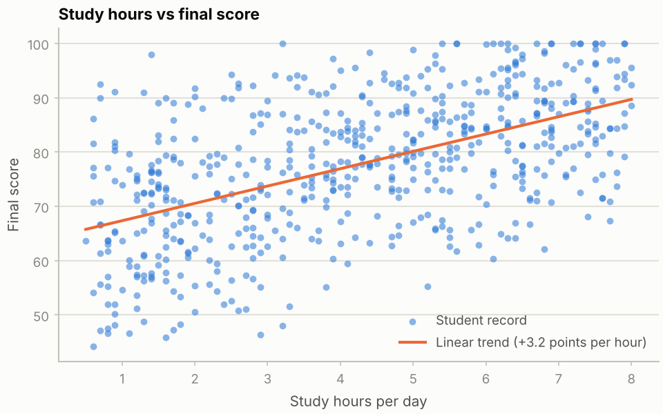

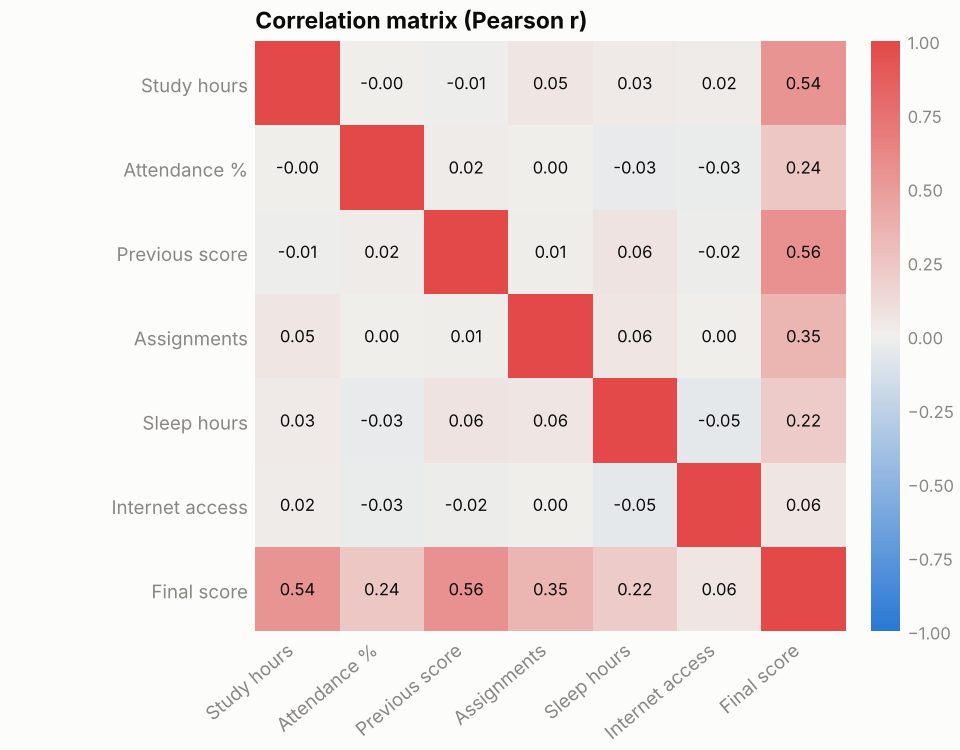

## 4. Methodology

1. Load the CSV and inspect descriptive statistics and correlations.
2. Split into **80 % training / 20 % test** with a fixed seed (42). The classification split is stratified so both sets keep the at-risk share.
3. Build scikit-learn **pipelines** (median imputation → optional polynomial features → optional standard scaling → model). Scaling is fitted inside each cross-validation fold, so no information leaks from the validation fold.
4. Include a **baseline** for each task (predict the mean score / never flag anyone). A model is only useful if it clearly beats it.
5. Rank every model by **5-fold cross-validation on the training data only** (MAE for regression, F1 for classification). The best non-baseline model is the one with the best cross-validation score.
6. Fit each model on the full training set and score it **once** on the test set.
7. Repeat the train/test split with **10 different seeds** to measure how much the test results depend on one lucky or unlucky split.
8. Study overfitting with a decision-tree depth sweep, tune hyperparameters with GridSearchCV, and compute impurity and permutation feature importance.
9. Serve all of this in the Streamlit app, which also offers an interactive prediction form.

The app and this report call the same code (`ml_core.py`, `plots.py`); `run_experiments.py` regenerates every table and figure below.

## 5. Models and evaluation metrics

| Task | Model | Settings |
|---|---|---|
| Both | Baseline | mean score / most frequent class |
| Regression | Linear Regression | ordinary least squares |
| Regression | Ridge (L2) | α = 1, standardised inputs |
| Regression | Lasso (L1) | α = 0.1, standardised inputs |
| Regression | Polynomial Regression | degree 2 (27 terms from 6 features) + Ridge α = 1 |
| Regression | SVM (SVR) | RBF kernel, C = 10, standardised inputs |
| Regression | Decision Tree / Random Forest | max depth 5 / 150 trees, max depth 8 |
| Classification | Logistic Regression | standardised inputs |
| Classification | Linear SVM / RBF SVM | C = 1, standardised inputs |
| Classification | Decision Tree / Random Forest | max depth 5 / 150 trees, max depth 8 |

- **MAE** — mean absolute error in score points (lower is better). **RMSE** — square root of the mean squared error; penalises large misses more. **R²** — share of score variation explained (1 is perfect, 0 is no better than the mean).
- **Accuracy** — fraction of correct predictions. **Precision** — fraction of flagged students who are truly at risk. **Recall** — fraction of at-risk students that were flagged. **F1** — harmonic mean of precision and recall.
- **Why F1 and not accuracy for classification:** only 9.2% of students are at risk, so a model that flags nobody scores 90.8% accuracy on the test set while being useless.

## 6. Results and discussion

### 6.1 Regression: predicting the final score

| Model | CV MAE (lower is better) | Test MAE | Test RMSE | Test R² |
|---|---|---|---|---|
| Linear Regression | 4.695 | 4.724 | 6.122 | 0.791 |
| Ridge (L2) | 4.697 | 4.721 | 6.120 | 0.791 |
| Lasso (L1) | 4.712 | 4.705 | 6.115 | 0.791 |
| Polynomial Regression (degree 2) | 4.712 | 4.804 | 6.229 | 0.783 |
| SVM (RBF) | 5.453 | 4.888 | 6.378 | 0.773 |
| Random Forest Regressor | 5.674 | 5.261 | 6.821 | 0.740 |
| Decision Tree Regressor | 7.168 | 6.385 | 8.170 | 0.627 |
| Baseline (predict the mean) | 10.207 | 10.955 | 13.379 | 0.000 |

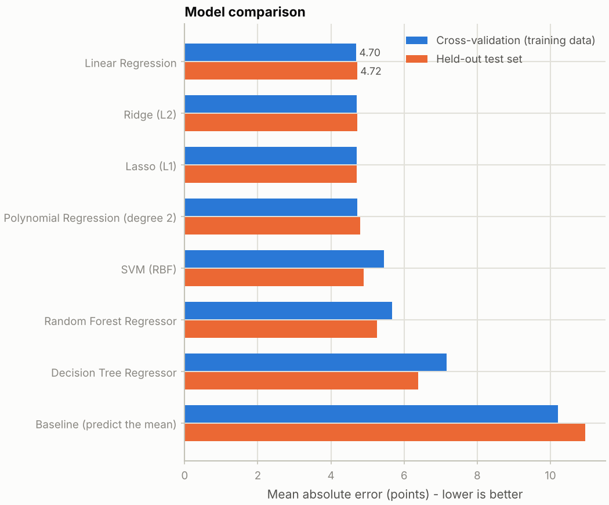

**Linear Regression had the lowest cross-validation MAE (4.695)**, narrowly ahead of Ridge (4.697), Lasso (4.712) and polynomial regression (4.712). On the test set it scored MAE 4.72, RMSE 6.12 and R² 0.79: 65% of test predictions were within 5 points of the true score and 90% within 10. The residuals are centred near zero (mean +0.1, standard deviation 6.1) and roughly bell-shaped. 5 of the 120 test predictions exceeded 100 (largest 104.2) because of the score ceiling; the app clips these.

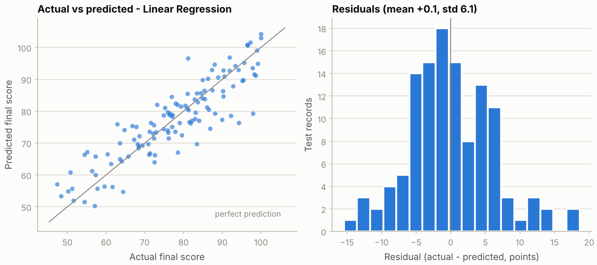

**Why regularisation and polynomial terms did not help.** Ridge and Lasso protect against overfitting when there are many features, noisy features or strongly correlated features. None applies here: there are only six features and 480 training rows, the features are almost uncorrelated, and Lasso removed no feature (0 of 6 coefficients set to zero), so there is nothing for L1 selection to discard. Adding 21 squared and interaction terms to get a degree-2 model did not lower the cross-validation error (4.712 vs 4.695), so there is no evidence of non-linearity strong enough to justify the extra complexity. The random forest (5.674) and the single decision tree (7.168) approximate a smooth, roughly additive relationship with step functions, a plausible reason why they trail; the RBF SVR (5.453) sits in between.

**How much is the ranking luck?** The single split above is one draw. Repeating the split with ten seeds gives:

| Model | Test MAE (mean ± std) | Test R² (mean ± std) |
|---|---|---|
| Linear Regression | 4.661 ± 0.258 | 0.793 ± 0.025 |
| Ridge (L2) | 4.662 ± 0.259 | 0.793 ± 0.025 |
| Lasso (L1) | 4.670 ± 0.264 | 0.793 ± 0.024 |
| Polynomial Regression (degree 2) | 4.737 ± 0.260 | 0.788 ± 0.026 |
| SVM (RBF) | 5.112 ± 0.382 | 0.750 ± 0.042 |
| Random Forest Regressor | 5.475 ± 0.381 | 0.727 ± 0.046 |
| Decision Tree Regressor | 7.038 ± 0.457 | 0.544 ± 0.057 |
| Baseline (predict the mean) | 10.357 ± 0.510 | -0.010 ± 0.012 |

The four linear-family models differ by less than 0.08 points on average, while the split-to-split standard deviation is about 0.26 — they are statistically tied, and Linear Regression is chosen as the simplest. The grouping (linear family, then SVR, then random forest, then tree, then baseline) is the same on average as in the single split.

### 6.2 What the linear model says about each feature

A linear model fitted to all 600 rows (descriptive only, not used for evaluation) reads directly in score points:

| Feature | Points per unit | Points per 1 std dev |
|---|---|---|
| Previous score | 0.35 | 6.95 |
| Study hours per day | 3.11 | 6.69 |
| Assignments completed (of 10) | 1.22 | 3.83 |
| Attendance (%) | 0.19 | 3.01 |
| Sleep hours per day | 1.41 | 2.03 |
| Internet access (1 = yes) | 1.89 | 0.95 |

Intercept 12.2. In plain terms: one extra daily study hour is associated with about 3.1 more points, one extra completed assignment with about 1.2, and ten extra points of previous score with about 3.5. These are associations in synthetic data, not causal effects.

### 6.3 Classification: flagging academic risk

At cut-off 60 the training set has 44 at-risk records out of 480 and the test set 11 out of 120.

| Model | CV F1 | Test Accuracy | Precision | Recall | F1-score |
|---|---|---|---|---|---|
| Logistic Regression | 0.738 | 0.942 | 0.750 | 0.545 | 0.632 |
| Linear SVM | 0.732 | 0.942 | 0.750 | 0.545 | 0.632 |
| RBF SVM | 0.698 | 0.958 | 0.875 | 0.636 | 0.737 |
| Decision Tree | 0.607 | 0.950 | 1.000 | 0.455 | 0.625 |
| Random Forest | 0.607 | 0.942 | 0.833 | 0.455 | 0.588 |
| Baseline (never at risk) | 0.000 | 0.908 | 0.000 | 0.000 | 0.000 |

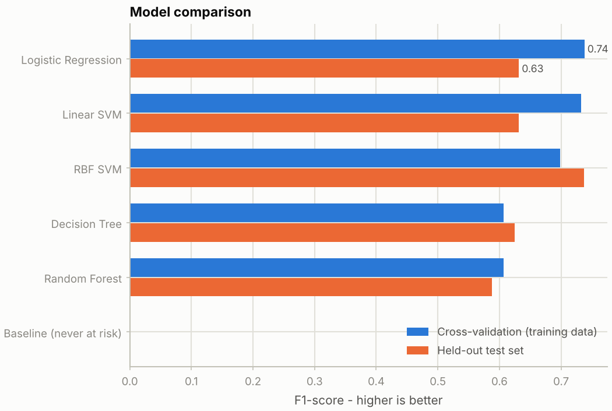

**Logistic Regression was selected** by cross-validation (CV F1 0.738, with Linear SVM close behind at 0.732). On the test set it reached accuracy 0.942, precision 0.75, recall 0.55 and F1 0.63. The confusion matrix shows 6 at-risk students caught, 5 missed and 2 students wrongly flagged.

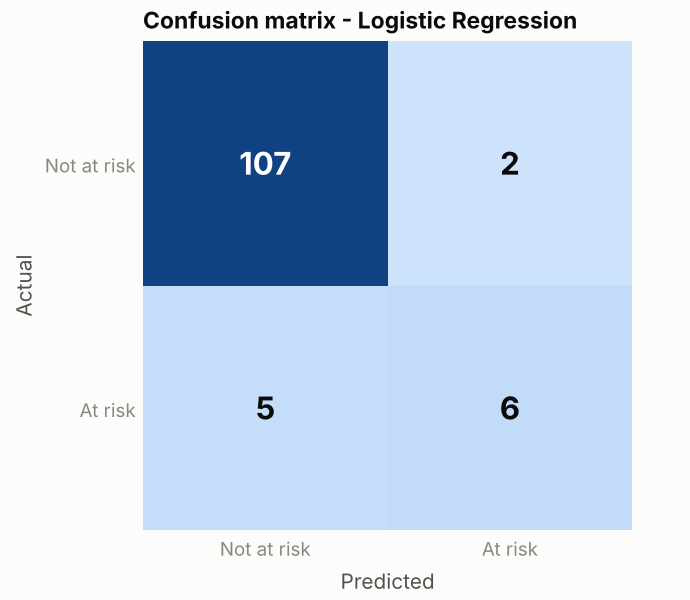

Three cautions apply when reading this table:

- **Accuracy is misleading.** The baseline that flags nobody already scores 0.908; the selected model gets only 4 more of the 120 test records right. Precision, recall and F1 carry the information.
- **11 test positives is a tiny sample.** Missing one more at-risk student changes recall by about 9 percentage points. RBF SVM has the highest *test* F1 (0.74) but a lower *cross-validation* F1 (0.698); choosing it because of the test score would be selecting on the test set, so it is not chosen.
- **The split itself matters.** Over ten random splits:

| Model | F1-score (mean ± std) | Recall (mean ± std) | Precision (mean ± std) |
|---|---|---|---|
| Logistic Regression | 0.771 ± 0.084 | 0.764 ± 0.143 | 0.799 ± 0.098 |
| Linear SVM | 0.748 ± 0.085 | 0.736 ± 0.132 | 0.779 ± 0.102 |
| RBF SVM | 0.663 ± 0.205 | 0.627 ± 0.262 | 0.779 ± 0.142 |
| Random Forest | 0.657 ± 0.134 | 0.536 ± 0.168 | 0.915 ± 0.100 |
| Decision Tree | 0.605 ± 0.085 | 0.627 ± 0.090 | 0.605 ± 0.159 |
| Baseline (never at risk) | 0.000 ± 0.000 | 0.000 ± 0.000 | 0.000 ± 0.000 |

Logistic Regression is again the strongest on average (F1 0.771 ± 0.084), but its F1 on the single reported split (0.63) is well below that average, and the RBF SVM and random forest vary considerably more from split to split.

**Class balancing trades precision for recall.** Re-running with `class_weight='balanced'` gives the rare class more weight:

| Model | CV F1 | Test Accuracy | Precision | Recall | F1-score |
|---|---|---|---|---|---|
| Linear SVM | 0.664 | 0.933 | 0.588 | 0.909 | 0.714 |
| Random Forest | 0.661 | 0.967 | 0.818 | 0.818 | 0.818 |
| Logistic Regression | 0.661 | 0.950 | 0.692 | 0.818 | 0.750 |
| RBF SVM | 0.606 | 0.917 | 0.529 | 0.818 | 0.643 |
| Decision Tree | 0.598 | 0.917 | 0.529 | 0.818 | 0.643 |
| Baseline (never at risk) | 0.000 | 0.908 | 0.000 | 0.000 | 0.000 |

Recall rises (logistic regression 0.55 → 0.82; linear SVM 0.55 → 0.91) while precision falls (logistic regression 0.75 → 0.69; linear SVM 0.75 → 0.59). With balancing, three models tie within 0.003 on cross-validation F1 (Linear SVM is marginally first), so the choice between them is not meaningful. Which setting is better depends on the cost of a miss versus a false alarm — a judgement for people, not for the metric.

**Sensitivity to the at-risk cut-off.** The same pipeline at five cut-offs:

| Cut-off | At-risk records | Train / test positives | Best model (CV F1) | CV F1 | Test precision | Test recall | Test F1 | Accuracy | Baseline accuracy |
|---|---|---|---|---|---|---|---|---|---|
| 50 | 12 | 10 / 2 | Decision Tree | 0.347 | 0.000 | 0.000 | 0.000 | 0.942 | 0.983 |
| 55 | 28 | 22 / 6 | Logistic Regression | 0.652 | 1.000 | 0.167 | 0.286 | 0.958 | 0.950 |
| 60 | 55 | 44 / 11 | Logistic Regression | 0.738 | 0.750 | 0.545 | 0.632 | 0.942 | 0.908 |
| 65 | 107 | 86 / 21 | Linear SVM | 0.672 | 0.875 | 0.667 | 0.757 | 0.925 | 0.825 |
| 70 | 159 | 127 / 32 | Linear SVM | 0.801 | 0.806 | 0.781 | 0.794 | 0.892 | 0.733 |

At cut-off 50 the apparently "best" model (a decision tree, CV F1 0.347) flagged **no one** in the test set (recall 0.0), and the do-nothing baseline's accuracy (0.983) beats every model's (0.942). At cut-off 55 only 6 test students are at risk and recall is 0.17. From cut-off 60 upward the test set has at least 11 at-risk students, enough for the metrics to carry some information, and test F1 rises from 0.63 to 0.79 as the at-risk group grows — but a broader definition of "at risk" also makes the label less specific. **The conclusions about the classifiers are therefore conditional on how "at risk" is defined.** Note also that the risk label is a thresholded version of the final score, so the classifier is a coarse restatement of the regression task, not a source of new information.

### 6.4 Overfitting and model complexity

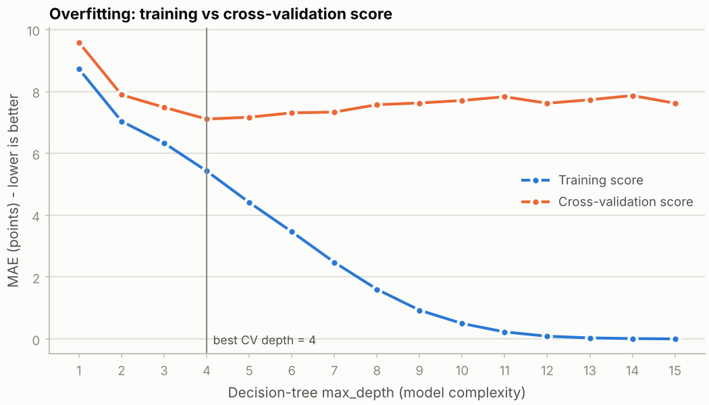

For a regression tree the **training MAE keeps falling** from 8.73 at depth 1 to 0.003 at depth 15 — the tree memorises every training record — while the **cross-validation MAE bottoms out at depth 4 (7.11) and then rises to about 7.6**. The widening gap is overfitting. For classification the same happens with F1: training F1 reaches 1.00 at depth 8, while cross-validation F1 plateaus near 0.61 (best at depth 7). Depth is the complexity dial: too shallow underfits, too deep overfits, and cross-validation is how the sweet spot is found. Note that even the best tree (7.11) is far worse than linear regression (4.70): picking the right *kind* of model matters more than tuning a wrong one. A depth-3 tree for each task is drawn in `figures/` and in the app's "Inspect a decision tree" panel; each node shows the split rule, the impurity and the class counts.

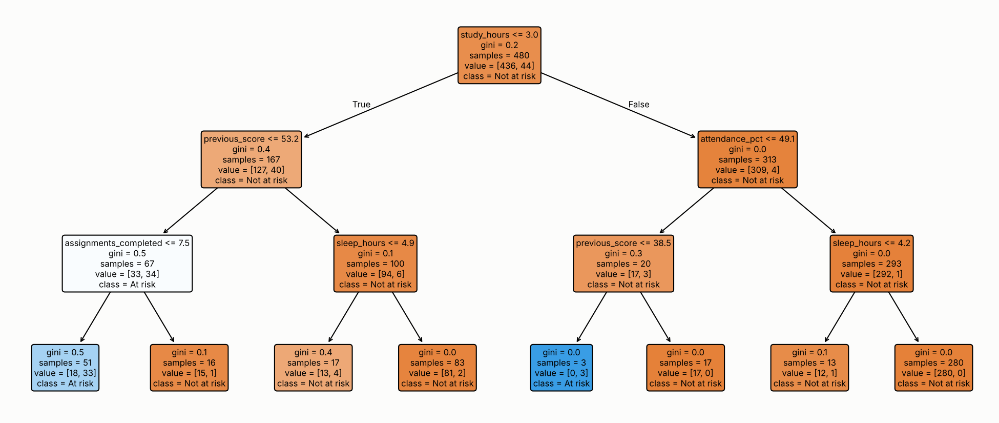

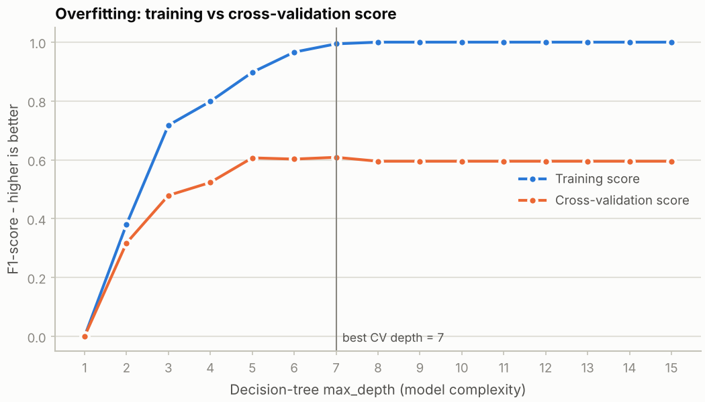

### 6.5 Hyperparameter tuning (GridSearchCV)

- **Random Forest regressor** (8 combinations of trees and depth, 5-fold CV): best `{'max_depth': 8, 'n_estimators': 150}`, CV MAE 5.674; test MAE 5.261, R² 0.740. This is exactly the setting the model comparison already used, and the top five combinations differ by about 0.04 MAE, so the grid is flat: tuning did not help.
- **SVM classifier** (linear kernel with three values of C, RBF kernel with three values of C and two gamma settings; 5-fold CV on F1): best `{'C': 1, 'kernel': 'linear'}`, CV F1 0.732; test F1 0.632. It matches the untuned linear SVM and still does not beat logistic regression (CV F1 0.738). The grid's best CV score is slightly optimistic because it is the maximum over several candidates; the test score is the fair number.

Tuning refines a model within its family; it cannot make a model family more suitable than another.

### 6.6 Feature importance

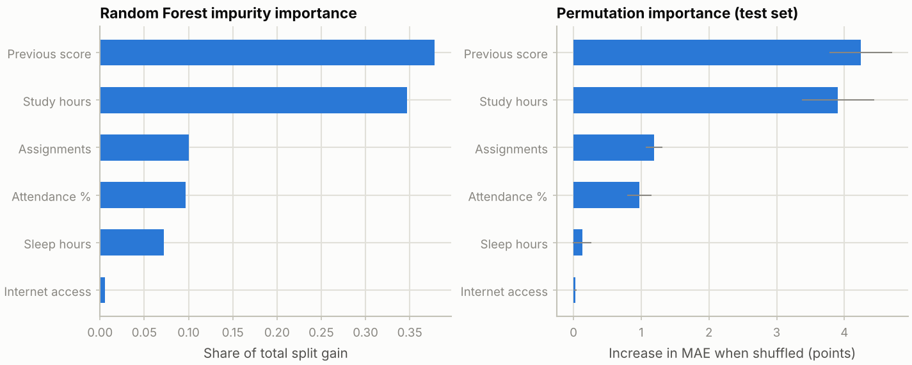

| Feature | Regression: impurity | Regression: permutation (MAE points) | Risk: impurity | Risk: permutation (ROC-AUC drop) |
|---|---|---|---|---|
| Previous score | 0.378 | 4.244 | 0.267 | 0.112 |
| Study hours per day | 0.347 | 3.907 | 0.281 | 0.191 |
| Assignments completed (of 10) | 0.100 | 1.190 | 0.129 | 0.004 |
| Attendance (%) | 0.097 | 0.974 | 0.175 | 0.039 |
| Sleep hours per day | 0.072 | 0.127 | 0.131 | -0.004 |
| Internet access (1 = yes) | 0.005 | 0.030 | 0.017 | 0.002 |

For regression, **previous score and study hours dominate** (shuffling either raises test MAE by about 4.2 and 3.9 points), followed by assignments (1.2) and attendance (1.0). Sleep (0.13 ± 0.14, within noise) and internet access (0.03) are close to zero for the forest, although the linear model assigns them small positive effects (2.0 and 0.9 points per standard deviation): a weak signal is easier for a linear model to pick up than for a forest. The ranking of the four main features agrees across both methods.

For risk classification, **study hours (0.19 ROC-AUC drop) and previous score (0.11)** matter most; attendance adds a little (0.04) and the rest are near zero. Impurity importance gives sleep hours (0.13) about the same credit as assignments (0.13) even though shuffling sleep hours changes nothing on held-out data (-0.004). This is a known weakness: impurity importance rewards features with many possible split points and is computed on training data, which is why the held-out permutation measure is shown alongside it. With only 11 at-risk test records, the classification importances are noisy.

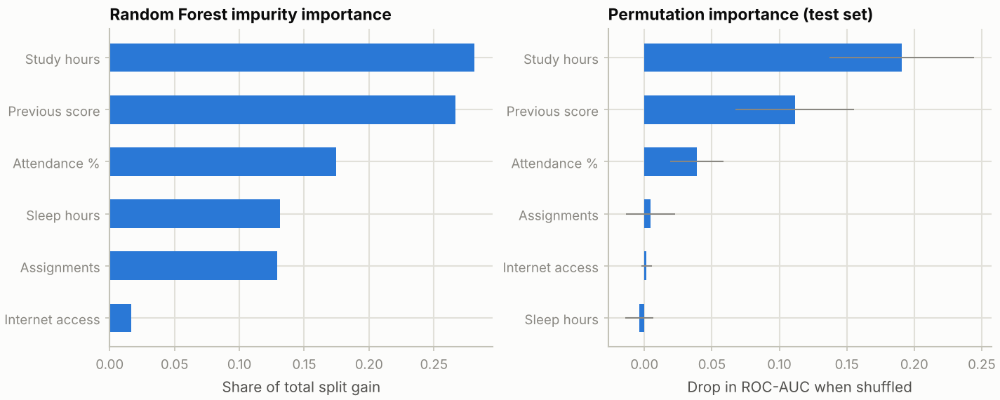

## 7. Limitations and ethics

- **Synthetic data.** The dataset cannot show that these features predict real outcomes; the relationships found are those built into the generator. Results are for demonstration and must not be presented as real-world findings.
- **Small positive class.** Even at the default cut-off there are 11 at-risk records in the test set. Classification metrics have wide uncertainty (Section 6.3) and the cut-off choice changes the conclusions.
- **The label is derived from the target.** Risk is defined by thresholding the score being predicted, so the classifier adds no information beyond the regression task.
- **Score ceiling.** 18 records are capped at 100, which slightly distorts a linear fit at the top end.
- **Selection optimism.** Choosing the best of several models by cross-validation on 480 rows is mildly optimistic, which is why the held-out test set and the repeated splits are reported.
- **Importance is not causation.** A feature the model relies on is not necessarily a cause of a good score.
- **Fairness and consent.** With real data, features such as internet access can act as proxies for family income or location, and a model could penalise students for circumstances outside their control. Real educational data would need permission, privacy safeguards, fairness checks across groups, validation and human review. The app must not be used to penalise students or make high-stakes decisions.

## 8. Conclusion

The project shows a complete, honest machine-learning workflow on one application. Cross-validation on training data selected the models; a baseline anchored what "good" means; a repeated-split check and a cut-off sensitivity study exposed how much of the classification result is noise; and the overfitting curve, tuning and importance analyses were consistent with the model comparison. The main findings are that **on this data simple linear models beat more flexible ones** (test R² 0.79), that **accuracy is a poor metric for a rare class**, and that **a model's headline score should be read together with its uncertainty and with the definition of the label it predicts**. All of it is illustrative because the data is synthetic.

## 9. Future work

- Replace the synthetic data with an approved real dataset and repeat the analysis with a fairness audit across groups.
- Use repeated stratified cross-validation or a larger dataset to stabilise the classification metrics.
- Try the regression model plus a threshold as the risk classifier and compare it with the direct classifiers.
- Add probability calibration and choose the alert threshold from the cost of a missed student versus a false alarm.

## 10. Reproducing these results

```bash
pip install -r requirements.txt
python run_experiments.py   # regenerates figures/ and results/ (about 30 seconds)
python test_project.py      # 9 checks on the data and the ML code
streamlit run app.py        # the interactive dashboard
```

The numbers above were produced with Python 3.13.16, scikit-learn 1.9.1, pandas 3.0.5, NumPy 2.5.3 and Matplotlib 3.11.2, with seed 42 for all splits, folds and forests. Other library versions can change the last decimal place, particularly for random forests. `results/tables.md` holds every table in plain form and `results/results.json` the raw values.

## References

- Pedregosa, F. et al. (2011). Scikit-learn: Machine Learning in Python. *Journal of Machine Learning Research*, 12, 2825–2830.
- Hastie, T., Tibshirani, R. & Friedman, J. (2009). *The Elements of Statistical Learning* (2nd ed.). Springer.
- Géron, A. (2022). *Hands-On Machine Learning with Scikit-Learn, Keras & TensorFlow* (3rd ed.). O'Reilly.
- Streamlit documentation, https://docs.streamlit.io
- scikit-learn user guide: cross-validation, model evaluation, permutation feature importance, https://scikit-learn.org/stable/user_guide.html
